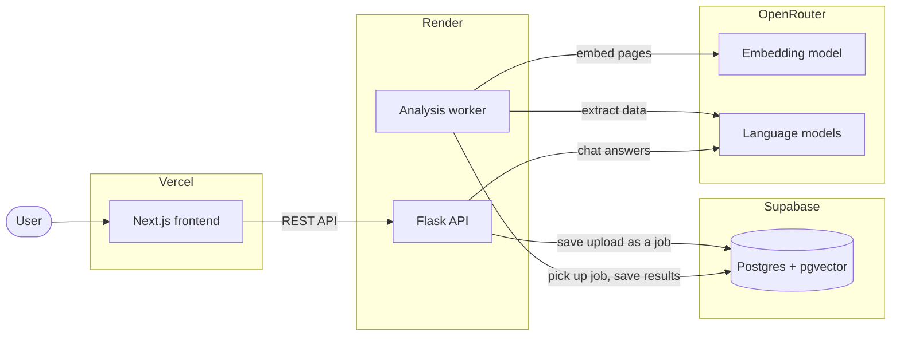

# FinAI Analyzer

FinAI Analyzer reads financial PDFs (annual reports, quarterly results, earnings releases, financial statements) and turns them into a dashboard you can check for yourself. Every figure on the dashboard links back to the page it came from, so nothing has to be taken on trust.

You upload a PDF and the backend works through it in the background. When it's done you get a report with the key figures, ratios, risks, outlook, auditor details and notes. Reports for the same company are combined into one company dashboard. You can ask questions about a report or a company in a chat window, and export the dashboard as a PowerPoint or PDF file.

Live app: https://finai-analyzer-three.vercel.app

## What it does

- Reads text-based PDFs directly, and scanned PDFs through OCR that runs in the browser
- Extracts the income statement, balance sheet, cash flow, segments, geographies, risks, outlook, auditor details and notes
- Checks every extracted figure against the page it was cited from, and only shows figures that pass
- Builds one dashboard per company from all of its reports, and flags figures that disagree between reports
- Only compares periods of the same length, so a quarter is never compared with a half-year
- Answers questions in a chat that only uses verified figures and the document text
- Exports the dashboard as PPTX or PDF with the same content and design
- Keeps each user's reports private behind a login

## Architecture

The app has three parts, each on its own host: the frontend on Vercel, the backend on Render and the database on Supabase. The backend uses OpenRouter for every AI call.



**Frontend (Next.js on Vercel).** The pages for signing in, uploading, browsing reports, company dashboards and chat. It talks to the backend over a REST API and keeps the login session in a cookie. For scanned PDFs it runs OCR in the browser with Puter.js and sends the text back to the backend.

**Flask API (Render).** Handles login, uploads, job status, dashboards, chat and exports. An upload isn't analysed during the request. The API saves the file as a job in the database and answers straight away, and the frontend checks the job's progress until it's finished.

**Analysis worker (Render).** A background thread inside the same backend process. It picks up queued jobs from the database and runs the analysis described below. Because it lives in the backend process, there is only one service to deploy.

**Database (Supabase Postgres with pgvector).** Stores users, reports, jobs, companies, dashboards and the text of every page. The `pgvector` extension stores an embedding for each page, which is how the app finds the right pages for each question.

**OpenRouter.** One API key gives access to both the embedding model and the language models.

## How a report is analysed

1. **Read the text.** PyMuPDF pulls the text out of each page. If the PDF is scanned and has no text, the job waits while the browser runs OCR, then carries on with the OCR text.
2. **Classify the document.** A rule-based check decides what kind of document it is. Full annual reports get extra sections for segments and notes.
3. **Embed the pages.** Each page is turned into a vector by the embedding model and stored in the database. If the embedding service is unavailable, the pages are stored anyway and searches fall back to keyword search until the vectors can be added.
4. **Find the relevant pages.** For each section (income statement, balance sheet, cash flow and so on) the worker combines keyword search with vector similarity and picks the pages most likely to hold that section.
5. **Read the tables.** On those pages, PyMuPDF reads tables row by row so each label stays next to its own numbers.
6. **Extract the data.** Each section's pages go to the language model with a fixed set of fields to fill in. All sections run in parallel.
7. **Verify citations.** Every figure the model returns is looked up in the source pages. A figure only counts as verified if it appears on the page it was cited from.
8. **Re-check missing fields.** If important fields are still empty and there's time left, the worker does one more targeted search and model call for just those fields.
9. **Run consistency checks.** Simple accounting checks, such as assets equalling liabilities plus equity. Reports that fail are flagged for review.
10. **Update the dashboard.** The report is saved and the company dashboard is rebuilt from all of the company's reports, with breakdowns cleaned of totals and subtotals so nothing is counted twice.

Every model call has a time limit. If a model is slow or returns an error, the call moves to the fallback model, and if a section still fails the report is saved without it rather than failing completely.

## Models

| Purpose | Model |
| --- | --- |
| Page and question embeddings | `nvidia/nemotron-3-embed-1b:free` |
| Extraction and chat | `nvidia/nemotron-3-ultra-550b-a55b:free` |
| Fallback for extraction and chat | `nvidia/nemotron-3.5-super-vl:free` |
| OCR for scanned PDFs (in the browser) | Mistral OCR through Puter.js |

All of the OpenRouter models are free models. The extraction model's reasoning step is turned off, because for filling in fixed fields from a few pages it makes calls much slower without improving the answers.

Free models on OpenRouter are sometimes withdrawn. If one disappears, pick a replacement from https://openrouter.ai/models and set it with the environment variables below. The embedding model has to return vectors of the size set by `EMBEDDING_DIMENSIONS` in `backend/config.py`, which must match the `VECTOR` column in `backend/db/schema.sql`. If you change the size, the schema clears the old vectors on the next start and each report is re-embedded the next time it's searched.

## Running the project

You need Python, Node.js, Docker and an OpenRouter API key.

Choose a password for the local database and put it in a `.env` file next to `docker-compose.yml`. This file is ignored by git, so the password never ends up in the repository:

```bash
cp .env.example .env
```

Open `.env` and set `POSTGRES_PASSWORD`. Then start Postgres with pgvector:

```bash
docker compose up -d postgres
```

Start the backend:

```bash
cd backend
python3 -m venv .venv
source .venv/bin/activate
pip install -r requirements.txt
cp .env.example .env
python app.py
```

Before starting it, open `backend/.env`, put the same database password into `DATABASE_URL`, set `LLM_API_KEY` to your OpenRouter key and set `AUTH_SECRET` to a random string. You can generate one with:

```bash
python3 -c "import secrets; print(secrets.token_hex(32))"
```

The backend applies the database schema itself when it starts. Its `/health` endpoint shows whether the database and settings are working.

Start the frontend in a second terminal:

```bash
cd frontend
npm install
cp .env.local.example .env.local
npm run dev
```

Open the frontend in your browser, create an account and upload a PDF.

To run the database, backend and frontend together in Docker instead:

```bash
docker compose up --build
```

### Environment variables

The backend reads its settings from `backend/.env`. The ones you need to set are:

| Variable | Description |
| --- | --- |
| `DATABASE_URL` | Postgres connection string. The database needs the `vector` extension |
| `LLM_API_KEY` | OpenRouter API key, used for the language models and the embeddings |
| `AUTH_SECRET` | Secret used to sign login sessions |
| `CORS_ORIGINS` | Frontend URLs allowed to call the API, comma-separated |
| `FLASK_ENV` | Set to `production` when deployed, which makes login cookies secure |

The models can be changed with `LLM_PRIMARY_MODEL`, `LLM_REASONING_MODEL` (the fallback) and `EMBEDDING_MODEL_NAME`. Every other setting has a sensible default, listed in `backend/.env.example`.

The frontend needs one variable, `NEXT_PUBLIC_API_URL`, set to the backend's URL.
