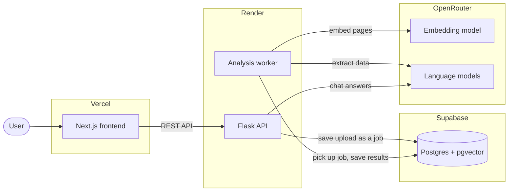

# FinAI Analyzer

FinAI Analyzer reads financial PDFs (annual reports, quarterly results, financial statements) and turns them into a dashboard you can actually trust. Every number on the dashboard links back to the page it came from, so you can check it yourself instead of taking the AI's word for it.

You upload a PDF, the backend works through it in the background, and a couple of minutes later you get a report with the key figures, ratios, risks, outlook and notes. Reports for the same company are merged into one company dashboard. You can also ask questions about a report in a chat window, and export the dashboard as a PowerPoint or PDF file.

Live app: https://finai-analyzer-three.vercel.app

## Features

- Upload text-based or scanned PDFs (scanned files are read with OCR in the browser)
- Extraction of the income statement, balance sheet, cash flow, segments, geographies, risks, outlook, auditor details and notes
- Page-level citations for every extracted value, checked against the source text
- One dashboard per company that combines all of its uploaded reports
- Detection of conflicting values between reports, and clear messages for data that isn't in the documents
- A chatbot that answers only from the verified data and the document text
- PPTX and PDF export of the same content shown on the dashboard
- Accounts with cookie-based login, so each user only sees their own reports

## Architecture

The app has three parts, each on its own host. The frontend runs on Vercel, the backend runs on Render, and the database runs on Supabase. The backend uses OpenRouter for all AI calls.



**Frontend (Next.js on Vercel).** The pages for login, upload, reports, company dashboards and chat. It talks to the backend over a REST API and keeps the login session in a cookie. For scanned PDFs it also runs OCR in the browser with Puter.js and sends the text back to the backend.

**Flask API (Render).** Handles login, uploads, job status, dashboards, chat and exports. An upload doesn't get analysed during the request. The API saves the file as a job in the database and returns straight away with a job id, and the frontend then polls the job status until it's done.

**Analysis worker (Render).** A background thread that runs inside the same backend process. It checks the database for queued jobs every couple of seconds, takes one, and runs the analysis steps described below. It's a thread rather than a separate service, so there is only one Docker service to deploy.

**Database (Supabase Postgres with pgvector).** Stores users, reports, jobs, companies, dashboards and the page text of every report. The `pgvector` extension stores the embedding of each page, which is used to find the right pages for each question.

**OpenRouter.** One API key gives access to both the embedding model and the language models. All the models in the default setup are free models.

## How a report is analysed

When a PDF is uploaded, the worker goes through these steps:

1. **Read the text.** PyMuPDF pulls the text out of each page. If the PDF has no text layer (a scanned file), the job pauses, the browser runs OCR, and the job continues with the OCR text.
2. **Classify the document.** A quick rule-based check looks at the text to decide what kind of document it is. Full annual reports (including 10-K and 20-F filings) get two extra sections, segments and notes, on top of the five used for every document.
3. **Embed the pages.** Every page is sent to the embedding model (`nvidia/llama-nemotron-embed-vl-1b-v2`). The pages go in batches of up to 128 per request, so most reports need a single request. Each page becomes a vector of 1024 numbers and is stored in the database.
4. **Find the relevant pages.** For each section (income statement, balance sheet, cash flow and so on) the worker runs a hybrid search. It combines full-text search in Postgres with vector similarity and picks the best 3 to 6 pages for that section.
5. **Extract tables.** For the pages that were picked, PyMuPDF also reads the tables row by row. This keeps each label next to its numbers, which plain text extraction often mixes up.
6. **Extract the data.** Each section's pages are sent to the language model with a fixed set of fields to fill in. All sections are sent at the same time, in parallel.
7. **Verify citations.** Every number the model returns is searched for in the source pages. A value only counts as verified when it's found on the page it was cited from.
8. **Re-check missing fields.** If important fields are still empty, the worker does one more search and model call aimed only at those fields.
9. **Run consistency checks.** Simple accounting checks, for example that assets equal liabilities plus equity. Reports that fail a check are flagged for review.
10. **Update the dashboard.** The report is saved, and the company dashboard is rebuilt from all of that company's reports, including any conflicts between them.

## Speed and time limits

A report usually takes around two to three minutes. Almost all of that time is the language model calls in steps 6 and 8. The other steps take a few seconds each, apart from table extraction, which can take around 20 seconds on a large report on Render's free plan.

Free models are sometimes slow or overloaded, so the backend puts a time limit on every model call:

| Setting | Default | What it does |
| --- | --- | --- |
| `LLM_ATTEMPT_TIMEOUT_SECONDS` | 80 | Longest a single model request can take before it's cancelled |
| `LLM_SECTION_BUDGET_SECONDS` | 105 | Total time for the extraction step (step 6), shared by all sections |
| `LLM_REEVALUATION_BUDGET_SECONDS` | 50 | Longest the re-check (step 8) can take |
| `ANALYSIS_TARGET_SECONDS` | 170 | If the job is already close to this, the re-check is skipped |

If the primary model times out, the call goes straight to the fallback model instead of trying the slow one again. Rate-limit errors are retried a few times with short waits. If a section still fails, the report is saved without it, and the re-check step can often fill in the missing fields.

Embeddings used to be calculated on the server with a small local model (`fastembed` with `bge-small`). On Render's free CPU that took about one second per page, which was the biggest single delay. They now come from the embedding API, which handles a whole report in a couple of seconds. It also embeds the full page text instead of a short piece of it, which finds the right pages more often.

## Models

| Purpose | Default model |
| --- | --- |
| Embeddings | `nvidia/llama-nemotron-embed-vl-1b-v2:free` (1024 dimensions) |
| Extraction and chat | `nvidia/nemotron-3-ultra-550b-a55b:free` |
| Fallback | `nvidia/nemotron-3.5-super-vl:free` |

All of them can be changed with environment variables (see below). Note that the vector column in the database is `VECTOR(1024)`. If you switch to an embedding model that can't return 1024 dimensions, update `EMBEDDING_DIMENSIONS` in `backend/config.py` and the column in `backend/db/schema.sql` together.

**Free model limits.** A free OpenRouter account can make 50 requests a day to free models. One report uses about 8 to 11 requests (one per section, the re-check, and two or three embedding requests), so a free account can analyse roughly four or five reports a day. When the limit is reached, jobs fail with a clear "quota exhausted" message. Adding $10 of credits to the OpenRouter account raises the limit to 1,000 requests a day.

## Database

The schema lives in `backend/db/schema.sql`. The backend runs it on every start, and it's safe to run more than once.

| Table | What it holds |
| --- | --- |
| `users` | Accounts and password hashes |
| `reports` | One row per uploaded document, with the extracted data as JSON |
| `analysis_jobs` | The job queue: status, progress, timings and errors |
| `document_chunks` | The text of each page and its embedding |
| `companies` | Companies found in the reports, per user |
| `company_dashboards` | Versions of each company dashboard |
| `export_jobs` | PPTX and PDF export history |

The embedding column changed from 384 to 1024 dimensions when the embedding model changed. The schema handles this by itself: on an older database it clears the old vectors, and each old report gets re-embedded automatically the first time it's searched again.

## Project structure

```text
FinAI-Analyzer/
├── backend/
│   ├── app.py                 Flask app, routes and worker start-up
│   ├── config.py              Settings read from environment variables
│   ├── db/schema.sql          Database schema
│   ├── routes/                API endpoints (auth, upload, jobs, reports, dashboard, chat)
│   ├── services/              Analysis logic
│   │   ├── ocr.py             Text and table extraction with PyMuPDF
│   │   ├── embeddings.py      Calls to the embedding API
│   │   ├── retrieval.py       Hybrid search
│   │   ├── llm.py             Prompts, model calls, timeouts and fallbacks
│   │   ├── curation.py        Citation checks and dashboard building
│   │   ├── presentation.py    PPTX and PDF export
│   │   └── db.py              Database queries
│   ├── workers/               Background analysis worker
│   ├── Dockerfile
│   └── requirements.txt
├── frontend/
│   ├── src/app/               Next.js pages
│   ├── src/components/        Dashboard, chat and layout components
│   ├── src/lib/               API client, auth and browser OCR
│   └── Dockerfile
├── docker-compose.yml         Local Postgres, backend and frontend
└── render.yaml                Render config for the backend
```

## Running locally

You need Python 3.11 or newer, Node.js 20 or newer, Docker and an OpenRouter API key.

Start Postgres with pgvector:

```bash
docker compose up -d postgres
```

Start the backend:

```bash
cd backend
python3 -m venv .venv
source .venv/bin/activate
pip install -r requirements.txt
cp .env.example .env
python app.py
```

Before running `python app.py`, open `backend/.env` and set `LLM_API_KEY` to your OpenRouter key and `AUTH_SECRET` to a random string. You can generate one with:

```bash
python3 -c "import secrets; print(secrets.token_hex(32))"
```

The backend runs on http://localhost:5000, and http://localhost:5000/health shows whether the database and settings are OK.

Start the frontend in a second terminal:

```bash
cd frontend
npm install
cp .env.local.example .env.local
npm run dev
```

Open http://localhost:3000, create an account and upload a PDF.

To run all three parts in Docker instead, use `docker compose up --build`.

## Environment variables

### Backend

| Variable | Required | Description |
| --- | --- | --- |
| `DATABASE_URL` | Yes | Postgres connection string. The database needs the `vector` extension |
| `LLM_API_KEY` | Yes | OpenRouter API key, used for both the language models and embeddings |
| `AUTH_SECRET` | Yes | Secret used to sign login sessions |
| `CORS_ORIGINS` | Yes | Frontend URLs allowed to call the API, comma-separated |
| `FRONTEND_ORIGIN` | No | One more allowed frontend URL |
| `FLASK_ENV` | No | Set to `production` when deployed, which makes cookies secure |
| `LLM_BASE_URL` | No | Defaults to `https://openrouter.ai/api/v1` |
| `LLM_PRIMARY_MODEL` | No | Main model for extraction and chat |
| `LLM_REASONING_MODEL` | No | Fallback model |
| `LLM_FAST_MODEL` | No | Small model for light tasks |
| `EMBEDDING_MODEL_NAME` | No | Embedding model, must support 1024 dimensions |
| `EMBEDDING_API_KEY` | No | Separate key for embeddings, defaults to `LLM_API_KEY` |
| `EMBEDDING_BATCH_SIZE` | No | Pages per embedding request, default 128 |
| `EMBEDDING_DOCUMENT_MAX_CHARS` | No | Characters of each page that get embedded, default 8000 |
| `LLM_ATTEMPT_TIMEOUT_SECONDS` | No | See [Speed and time limits](#speed-and-time-limits) |
| `LLM_SECTION_BUDGET_SECONDS` | No | See [Speed and time limits](#speed-and-time-limits) |
| `LLM_REEVALUATION_BUDGET_SECONDS` | No | See [Speed and time limits](#speed-and-time-limits) |
| `ANALYSIS_TARGET_SECONDS` | No | See [Speed and time limits](#speed-and-time-limits) |
| `MAX_UPLOAD_MB` | No | Largest allowed upload, default 20 |
| `JWT_EXPIRY_DAYS` | No | How long a login lasts, default 7 |
| `JOB_POLL_INTERVAL_SECONDS` | No | How often the worker checks for new jobs, default 2 |
| `JOB_STALE_AFTER_SECONDS` | No | When a stuck job is picked up again, default 300 |
| `JOB_MAX_RETRIES` | No | How many times a failed job is retried, default 3 |
| `JOB_OCR_TIMEOUT_SECONDS` | No | How long a job waits for browser OCR, default 900 |
| `MAX_QUERY_LENGTH` | No | Longest allowed chat question, default 2000 |
| `LOG_LEVEL` | No | Defaults to `INFO` |

### Frontend

| Variable | Required | Description |
| --- | --- | --- |
| `NEXT_PUBLIC_API_URL` | Yes | Public URL of the backend |

## Deployment

The production setup uses free tiers of three services.

**Database on Supabase.** Create a project and run `backend/db/schema.sql` once (the backend also runs it on start). Use the session pooler connection string (port 5432 on `*.pooler.supabase.com`) as `DATABASE_URL`. Render can only connect over IPv4, and Supabase's direct database host is IPv6 only.

**Backend on Render.** Create a Docker web service from this repo with `backend` as the root directory, or use `render.yaml`. Set the required environment variables above, with `FLASK_ENV=production` and `CORS_ORIGINS` set to the Vercel URL. The service redeploys automatically on every push to `main`. The health check path is `/health`.

**Frontend on Vercel.** Create a project from the `frontend` folder and set `NEXT_PUBLIC_API_URL` to the Render URL. The default build works on Vercel as it is. The `frontend/Dockerfile` sets `NEXT_OUTPUT=standalone` for its own build, so the same code also runs in Docker.

On Render's free plan the backend goes to sleep after 15 minutes without traffic. The first request after that takes about a minute while it wakes up, and jobs uploaded while it's asleep start once it's awake.

## API

All routes except `/health`, `/api/auth/signup` and `/api/auth/login` need the login cookie.

| Route | Method | Description |
| --- | --- | --- |
| `/health` | GET | Health check for the database and settings |
| `/api/auth/signup` | POST | Create an account |
| `/api/auth/login` | POST | Log in |
| `/api/auth/logout` | POST | Log out |
| `/api/auth/me` | GET | Current user |
| `/upload/` | POST | Upload a PDF and queue it for analysis |
| `/jobs/{job_id}/status` | GET | Status of an analysis job |
| `/jobs/by-report/{report_id}/status` | GET | Latest job for a report |
| `/jobs/{job_id}/ocr-document` | GET | PDF file for browser OCR |
| `/jobs/{job_id}/ocr-result` | POST | Send the browser OCR text |
| `/fetch_data/{id}` | GET | One report |
| `/fetch_data/{id}` | DELETE | Delete a report |
| `/fetch_all_data/?limit=&offset=` | GET | List of the user's reports |
| `/api/reports/{id}/diagnostics` | GET | Completeness and consistency checks for a report |
| `/api/dashboard` | GET | List of the user's company dashboards |
| `/api/companies/{id}/dashboard` | GET | Company dashboard |
| `/api/reports/{id}/dashboard` | GET | Dashboard for a single report |
| `/api/companies/{id}/presentation?format=pptx\|pdf` | GET | Export a company dashboard |
| `/api/reports/{id}/presentation?format=pptx\|pdf` | GET | Export a single report |
| `/query/` | POST | Ask the chatbot a question |

## Security and privacy

- Logins use signed JWTs in httpOnly cookies, which are marked secure in production.
- Every query checks that the report, job or company belongs to the logged-in user.
- URLs and API responses only use random UUIDs, never the internal database ids.
- Only PDF files up to the size limit are accepted, and the uploaded file is deleted from the job once it has been processed.
- Errors from the AI providers aren't shown to users as-is.
- Page text is sent to OpenRouter for embeddings and extraction. Free models on OpenRouter may log what they receive, so keep that in mind before uploading confidential documents.

## Known limitations

- Extraction quality depends on how the PDF is laid out. Complicated tables are still the most common source of missing fields.
- Figures in different currencies aren't converted.
- Scanned PDFs need the browser tab to stay open while OCR runs.
- Chat history is kept only for the current page session.
- The worker runs inside the backend process. If you run more than one backend instance, they will share the job queue through the database, which works, but each one will also run its own worker.
